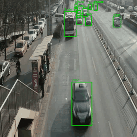
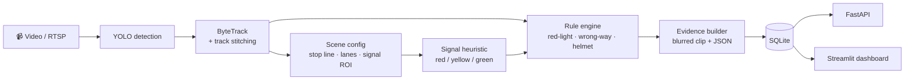

<div align="center">

# 🚦 Traffic Violation Detection

**End-to-end computer-vision pipeline that flags traffic-rule violations
as reviewable candidate events — never automated penalties.**

[](pyproject.toml)
[](pyproject.toml)
[](tests/)
[](Dockerfile)



*Detection + ByteTrack tracking on real footage (UA-DETRAC MVI_20012).
Plates and faces are blurred in stored evidence by default.*

[Quick start](#-quick-start) · [Results](#-results) · [Novelty](#-novelty-track-stitching) · [Docs](#-documentation) · [Reproduce](#-reproducibility)

</div>

---

## 📋 Contents

- [Overview](#-overview)
- [Highlights](#-highlights)
- [Architecture](#-architecture)
- [Quick start](#-quick-start)
- [Results](#-results)
- [Novelty: track stitching](#-novelty-track-stitching)
- [Usage guide](#-usage-guide)
- [Documentation](#-documentation)
- [Reproducibility](#-reproducibility)
- [Privacy & ethics](#-privacy--ethics)

## 🔍 Overview

Traffic violations are rare events buried in hours of footage. This system
detects and tracks vehicles, understands each camera's scene (stop line,
lanes, signal state), applies a rule engine (red-light, wrong-way; helmet
non-use as an extension), and produces blurred, review-ready evidence clips
behind a FastAPI + Streamlit dashboard.

> **Scope note:** every output is a *candidate event for human review* —
> never an automated penalty. Raw footage of people is never committed.

## ✨ Highlights

| | |
|---|---|
| 🎯 **Vehicle detector** | mAP@0.5 **0.970** / mAP@0.5:0.95 **0.841** (UA-DETRAC val) |
| 🪖 **Extension detectors** | helmet **0.920**, plate **0.974** mAP@0.5 |
| 🎬 **Real-video event eval** | P = R = F1 = **1.000** on a hand-verified 3-clip set |
| 🧩 **Track stitching (novelty)** | event recall **0.33 → 0.59 → 0.96** under 10–30% track dropout, zero precision cost |
| 🌧️ **Degradation robustness** | night/rain/glare mAP@0.5 drop ≤ **0.03** |
| 📦 **Fresh-clone demo** | `make demo` or `docker run --rm tvd` — no datasets or weights needed |

## 🏗️ Architecture



Everything is driven by YAML configs (per-camera scene calibration, tracker,
extensions) — no magic numbers in code. Extensions (helmet, ANPR) are off by
default for privacy.

## 🚀 Quick start

**Option A — local, from a fresh clone** (COCO weights only, no datasets):

```bash
make setup
make demo        # synthetic video -> pipeline -> rule eval
```

**Option B — Docker** (CPU-only, nothing to install):

```bash
docker build -t tvd .
docker run --rm tvd                          # synthetic demo + rule eval
docker run --rm tvd python -m pytest -q      # 102-test suite instead
```

**Option C — real footage** (needs trained weights, gitignored):

```bash
# annotated tracking video of the bundled UA-DETRAC sample:
python scripts/run_video.py --video data/samples/detrac_mvi20012.mp4 \
    --weights weights/detector.pt --run-name detrac-demo

# full pipeline with evidence + dashboard:
python scripts/run_pipeline.py --video <clip.mp4> --scene configs/scene.<cam>.yaml \
    --weights weights/detector.pt
streamlit run src/tvd/ui/dashboard.py -- --db results/events.db
```

## 📊 Results

All numbers come from real, seeded runs; unmeasured items are marked "not run"
in `docs/REPORT.md`.

<details open>
<summary><b>Detection mAP</b> (val splits, seed 42 — full tables in <code>docs/RESULTS.md</code>)</summary>

| model | mAP@0.5 | mAP@0.5:0.95 |
|---|---|---|
| vehicle (`weights/detector.pt`, UA-DETRAC val, 500 img) | 0.970 | 0.841 |
| helmet (`weights/helmet.pt`, 372 img) | 0.920 | 0.586 |
| plate (`weights/plate.pt`, 2048 img) | 0.974 | 0.687 |

Degradations (UA-DETRAC val, `docs/ROBUSTNESS.md`): night 0.947 · rain 0.970 ·
glare 0.969 vs clean 0.970 (mAP@0.5).
</details>

<details open>
<summary><b>Event-level rules</b> (synthetic scenarios + real-video constructed set)</summary>

| suite | P | R | F1 |
|---|---|---|---|
| 9 synthetic-trajectory scenarios | 1.000 | 1.000 | 1.000 |
| 3-clip real-video set (negative · wrong-way · red-light) | 1.000 | 1.000 | 1.000 |

The real-video set (`configs/event_set.yaml`) uses ground truth by
construction (reversed playback, synthetic signal overlay) and caught two
real failure modes before field use — see `docs/REPORT.md`.
</details>

## 🧩 Novelty: track stitching

Tracker gaps and ID switches fragment vehicles, so rule engines silently lose
violations. This project adds a **lightweight online tracklet stitcher**
(`src/tvd/track/stitch.py`) — constant-velocity geometric gating, no re-id
model — with a matching gap tolerance in the rule engine.

Event recall under seeded track dropout (means over 3 seeds, precision = 1.000
everywhere; `docs/EVENT_ROBUSTNESS.md`):

| dropout | stitching off | stitching on |
|---|---|---|
| 10% random | 0.593 | **0.963** |
| 20% random | 0.370 | **0.704** |
| 30% random | 0.333 | **0.593** |
| occlusion bursts (4 f) | 0.778 | **0.889** |
| occlusion bursts (8 f) | 0.630 | 0.630 *(beyond the gate — honest limit)* |

## 📖 Usage guide

<details>
<summary><b>Train & evaluate the detector</b> (Phase 1)</summary>

```bash
# put a YOLO-format dataset in data/ (see docs/DATA.md), then:
python scripts/train_detector.py --train-config configs/train.yaml
python scripts/eval_detector.py --weights weights/detector.pt
# pipeline smoke test (tiny coco8 sample, 1 epoch):
python scripts/train_detector.py --train-config configs/train.smoke.yaml
```

The eval script regenerates `docs/RESULTS.md` (committed) and
`results/detection/<run>/metrics.json` (gitignored).
</details>

<details>
<summary><b>Tracking & stitching</b> (Phase 2)</summary>

```bash
# track a video: writes MOT tracks, trajectories CSV, annotated mp4, summary
python scripts/run_video.py --video <clip.mp4> --weights weights/detector.pt

# tracking metrics (HOTA/IDF1/ID switches/MOTA) against MOT ground truth:
# 1) obtain UA-DETRAC video + annotation XMLs (request form, see docs/DATA.md)
# 2) python scripts/convert_detrac_to_mot.py --annotations-dir <xml dir> \
#      --videos-dir <avi dir> --out-dir data/detrac_mot
# 3) python scripts/eval_tracking.py --video <avi dir>/<seq>.avi \
#      --weights weights/detector.pt --gt-folder data/detrac_mot
```

Note: trackeval 1.3.0 only allows the 'pedestrian' class slot for custom MOT
benchmarks; vehicle GT is mapped to that slot (class id 1).

Track stitching (geometry-only, on by default via `configs/tracker.yaml`)
re-links tracklets across short gaps; the event-level dropout study is in
`docs/EVENT_ROBUSTNESS.md` (regenerate with `python scripts/eval_dropout.py`).
</details>

<details>
<summary><b>Scene calibration & signal state</b> (Phase 3)</summary>

```bash
# interactively annotate a camera view (stop line, lanes+directions, signal ROI)
python scripts/annotate_scene.py --camera-id cam-01 \
    --video <clip.mp4> --out configs/scene.cam-01.yaml
```

Committed scene configs (`configs/scene.*.yaml`) are covered by
`tests/test_scene_configs.py`: every view must validate (Phase 3 exit).
Cameras with no visible signal set `signal_roi: null`, which disables the
red-light rule for that view.
</details>

<details>
<summary><b>Rule engine & event evaluation</b> (Phase 4)</summary>

```bash
python scripts/eval_rules.py   # synthetic scenarios: event-level P/R/F1 + false alerts/hour

# real-video event set (manifest configs/event_set.yaml; build derived clips first):
python scripts/build_event_set.py
python scripts/eval_events.py
```

The real-video set covers a negative clip (normal traffic), a constructed
wrong-way clip (reversed playback), and a constructed red-light clip
(synthetic signal overlay, 2 genuine events).
</details>

<details>
<summary><b>Evidence pipeline & dashboard</b> (Phase 5)</summary>

```bash
# end-to-end: video -> detect -> track -> signal -> rules -> evidence -> SQLite
python scripts/run_pipeline.py --video <clip.mp4> --scene configs/scene.<cam>.yaml \
    --weights weights/detector.pt

# review API (serves events + blurred evidence clips)
uvicorn tvd.api.main:app --port 8000

# review dashboard
streamlit run src/tvd/ui/dashboard.py -- --db results/events.db
```

Plates/faces are blurred in stored evidence by default (the blur region is a
heuristic plate band).
</details>

<details>
<summary><b>Demo assets</b></summary>

```bash
# README hero GIF from an annotated tracking video (docs/assets/, committed):
python scripts/make_demo_gif.py
```

The bundled sample clip shows normal traffic, so the rule engine correctly
flags no events; for flagged-event evidence clips, run
`scripts/run_pipeline.py` on footage containing a violation (evidence lands
in `results/pipeline/<run>/evidence/`).
</details>

## 📚 Documentation

| doc | contents |
|---|---|
| `docs/REPORT.md` | final report: measured results, limitations, reproduction |
| `docs/RESULTS.md` | detector mAP tables (regenerated from real runs) |
| `docs/EVENT_ROBUSTNESS.md` | track-dropout robustness study (stitching on/off) |
| `docs/ROBUSTNESS.md` | night/rain/glare degradation table |
| `docs/DATA.md` | dataset sources, licenses, download notes |
| `docs/PRIVACY.md` | privacy & ethics note |
| `docs/PRESENTATION.md` | slide-deck content for a project defense |
| `docs/PORTFOLIO.md` | CV / LinkedIn / elevator-pitch text |

Repository layout:

```
configs/            model, tracker, system, per-camera scenes, event-set manifest (YAML)
src/tvd/            library: detect/ track/ scene/ signal/ rules/ evidence/ api/ ui/ utils/
scripts/            train, eval, run_video, pipeline, demo-asset generators
tests/              pytest suite (includes synthetic-trajectory rule tests)
data/               gitignored; see docs/DATA.md
results/            gitignored run outputs
```

## 🔁 Reproducibility

- All runs are seeded (`configs/system.yaml`) and log their config; results
  files are regenerated from real runs only.
- Pinned dependencies (`pyproject.toml`); `make setup|test|lint|demo`.
- Fresh clone reproduces the demo: `make demo` or
  `docker build -t tvd . && docker run --rm tvd`.

## 🛡️ Privacy & ethics

Output is always a candidate for human review. Plates/faces are blurred in
stored evidence by default; evidence clips are short windows, not continuous
footage. See `docs/PRIVACY.md` for the operating policy and `docs/DATA.md`
for dataset licenses. Raw footage of people is never committed.
